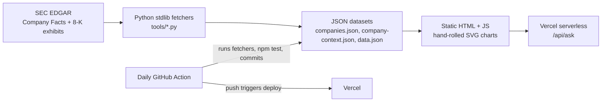

# Multi-Company FP&A Dashboard

A CFO-style FP&A dashboard for 11 public tech companies, built only from SEC filings, refreshed daily, with every number traceable to its source.

**Live: https://findashboard.vercel.app**

[](https://github.com/gwaghmar/multi-company-fpa-dashboard/actions/workflows/refresh-company-data.yml)


## What it is

Pick Apple, Alphabet, NVIDIA, Microsoft, Amazon, Meta, AMD, Broadcom, Oracle, Salesforce or Intel and get the views a finance team uses: revenue, variance bridge, profitability, liquidity, capital returns, outlook, scenarios and a peer table. All figures come from SEC EDGAR (Company Facts and 8-K earnings exhibits). Each period links to the 10-Q or 10-K it came from, and each value is labeled by how it was produced. Where a company does not file a figure, the dashboard says UNAVAILABLE instead of estimating it.

## Why it stands out

- **As-originally-filed data with restatement tracking.** The first filing of a fact wins, so quarters add up to the filed year-to-date figures. A separate pass lists prior-period figures that later filings report differently (12-quarter lookback).
- **Forecast ledger.** Calls on unfiled quarters are locked with a SHA-256 hash and graded against the filed actuals. Management guidance from 8-K exhibits is graded the same way (guided range vs actual, inside or outside, midpoint error).
- **Calendar-aligned peer table.** Companies with different fiscal calendars are mapped to the nearest calendar quarter so they can be compared side by side.
- **Ask AI grounded in filed data.** A Claude-backed assistant receives the selected company, period, tab and filed evidence. If the data is not there, it says so.
- **Evidence labels on every number.** REAL (filed), DERIVED (arithmetic on filed values), MODELED (assumption-driven) or UNAVAILABLE.
- **Automated daily refresh with tests.** A GitHub Action rebuilds the data every day and runs 61 automated tests (count read from `status.json`). Data is committed, and so deployed, only if they pass.

## How it works



- **Fetchers:** `tools/fetch_company_sources.py`, `tools/fetch_public_context.py` and `tools/fetch_edgar_data.py` use only the Python standard library.
- **Frontend:** one `index.html` plus plain JavaScript, no framework and no build step. Charts are hand-written SVG.
- **Ask AI:** `api/ask.js` is a Vercel serverless function that calls Claude server-side, so the key never reaches the browser. It hands the model deterministic data-tool results rather than the whole database.
- **Refresh:** `.github/workflows/refresh-company-data.yml` runs daily at 10:17 UTC (and on demand). It rebuilds the datasets, runs `npm test`, writes `status.json`, and commits only if the tests pass. The Vercel project is Git-integrated, so the commit triggers the deploy.

**Stack:** Python 3.12 (stdlib), Node.js (built-in test runner), vanilla JavaScript, SVG, Vercel, GitHub Actions, Claude API.

**Tabs:** Home, Executive Review, Revenue, Variance Analysis, Planning & Scenarios, Profitability & Opex, Hardware COGS & Inventory, Liquidity & Working Capital, Treasury & Capital, Workforce & Investment, Outlook & IR, Sustainability, Peers, Forecasts, Reports. Apple has the richest detail (product, geography, headcount, environmental). Other companies show standardized SEC metrics and mark everything else UNAVAILABLE.

## Run it locally

```bash
python3 -m http.server 4173        # open http://localhost:4173/ (Ask AI needs the Vercel function)
npm test                           # runs the node:test suite (no dependencies to install)

# rebuild data from SEC EDGAR (set a contact user agent first)
export SEC_USER_AGENT="Your Name your@email.com"
python3 tools/fetch_company_sources.py      # companies.json
python3 tools/fetch_public_context.py       # company-context.json
python3 tools/fetch_edgar_data.py --no-csv  # data.json (Apple detail)
node tools/write_status.mjs                 # status.json (test counts for the header strip)
```

To enable Ask AI on your own deployment, add `ANTHROPIC_API_KEY` in the Vercel project environment variables and redeploy. Without it the UI says Ask AI is not configured yet.

## Data integrity rules

Full detail is in [DATA_PROVENANCE.md](DATA_PROVENANCE.md). The short version:

1. **One XBRL tag per metric per company.** Candidate tags are never pooled. The chosen tag is recorded in `metricTags`. A renamed-tag fallback is allowed only for dividends and interest expense, and only after a bridge check shows identical values on shared spans.
2. **As originally filed.** When a fact is filed more than once, the earliest filing wins, so both ends of a YTD subtraction come from the same vintage.
3. **Quarters are built from filed facts.** Cash-flow quarters are differences of consecutive YTD facts. Fiscal Q4 is the annual figure minus the first three quarters and is listed in `derivedMetrics`.
4. **Debt is balance-sheet carrying value**, never a note-table principal figure. If the noncurrent piece is not filed, total debt is null.
5. **Source attribution.** Each period cites the filing that first reported it, with form, date, accession and SEC URL.
6. **No cross-company fallbacks.** Missing fields show UNAVAILABLE and name the source that would be needed.
7. **Planning & Scenarios is always MODELED.** It applies visible assumptions to the latest filed quarter and is not guidance, consensus or a budget.
8. **Non-SEC data is curated by hand and labeled.** Environmental figures come from each company's own report. OpenAI and Anthropic appear as private-company snapshots (REAL vs REPORTED) and are outside the SEC pipeline.

## Forecast ledger details

`forecasts.json` ships empty. Nothing in it is generated: only a call you lock with the helper appears. Numbers are USD millions.

```bash
node tools/add_forecast.mjs apple "Q4 FY26" 2026-09-26 --revenue 112000 --gm 47.0 --opex 19500 [--note "..."]
```

The helper sets `lockedAt` to today, computes the hash, appends the entry, refuses a duplicate id, and refuses any `periodEnd` at or before the company's latest period in `companies.json` (no backfilling). It warns when the company does not file SG&A under the standard tag, because opex then cannot be graded. Entry shape (values are a format example only):

```json
{"id":"apple-2026-09-26","company":"apple","label":"Q4 FY26","periodEnd":"2026-09-26",
 "revenue":112000,"grossMarginPct":47.0,"opex":19500,"note":"","lockedAt":"2026-10-14",
 "hash":"<sha256 of id|company|label|periodEnd|revenue|grossMarginPct|opex|lockedAt>"}
```

`npm test` rechecks every entry: unique ids, hash recomputes, sorted by `lockedAt`, label matches `companies.json`, and `lockedAt` is before the period's first filing when that is known, otherwise not in the future. Git history is the audit trail. `lockedAt` is self-reported: the hash and git history show that an entry did not change after it was committed, not when it was first written.

Filed guidance comes from `guidance` in `company-context.json` (built from SEC 8-K exhibits only): one verbatim sentence with its source link and date, or `null`. The dashboard parses ranges at render time for these shapes: `$61-64 billion`, `$15.8 billion to $16.8 billion`, `between $X and $Y`, `plus or minus N%`, `plus or minus $N` (the last two are tagged DERIVED), and `approximately $34.8 billion`. Anything else shows the excerpt with "Range not parsed". Annual guidance is not graded.

**Forecast accuracy** appears once any call is graded: calls graded, mean absolute revenue error, bias, mean absolute gross margin error in points, and mean absolute opex error where SG&A is filed under the standard tag.

**Management guidance vs actual** grades every sentence in `guidanceHistory`. Guidance filed on date D targets the first period in `companies.json` whose `periodEnd` is after D. Until that quarter is filed the row says "Awaiting filing". Afterward it shows the guided range, actual revenue, inside or outside, and midpoint error.

**Figures changed in later filings** reads `restatements` from `companies.json`. A test checks that every listed row's `firstValue` equals the value shown for that period.

## Ask AI details

Dashboard AI receives the selected company, fiscal period, tab, supported filters, source evidence and visible scenario assumptions: standardized SEC metrics, tab-scoped management excerpts from SEC-filed earnings materials, the latest 10-K context, and U.S. Treasury, BLS and ECB macro data for Planning and Treasury. Fiscal YTD values are sent only for a true fiscal YTD selection, so a single quarter is never answered with a YTD or full-year figure. General AI receives no dashboard evidence.

## About me

**Govind Waghmare**, New York. Open to FP&A, finance systems and finance analytics roles.

- **Manager, Financial Applications, Omnicom Group (2023 to present).** Owns the Cognos and TM1 (Planning Analytics) platforms for global FP&A. Consolidates multi-ERP data (D365, NetSuite, SAP, Workday) into Azure Synapse. Leads AI-enabled analytics rollouts (Databricks Genie, Azure AI Foundry, Copilot Studio). Manages SOX ITGC/ITAC controls.
- **Business Intelligence Analyst, TDS Telecommunications.** SQL, Alteryx, Tableau, Power BI and Snowflake; Capex/Opex variance analysis.
- **Founder, logistics company in Mumbai (2018 to 2021).** Founded and ran it.
- **Education:** MS Business Intelligence & Data Analytics, Stevens Institute of Technology. M.Com Finance & Accounting, University of Mumbai.
- **Skills:** FP&A systems (TM1, OneStream, Adaptive, Hyperion); ERP (D365, SAP, NetSuite, Workday); data (SQL, Python, Databricks, Snowflake, Azure Synapse); BI (Cognos, Power BI, Tableau).

Website: https://www.govindwaghmare.me/ | LinkedIn: https://www.linkedin.com/in/govindw/

## How this was built

I built this with AI coding assistants (Claude Code) under my direction. The finance logic, data rules, tests and data checks are ones I specified and reviewed, and the automated tests run on every daily refresh.
